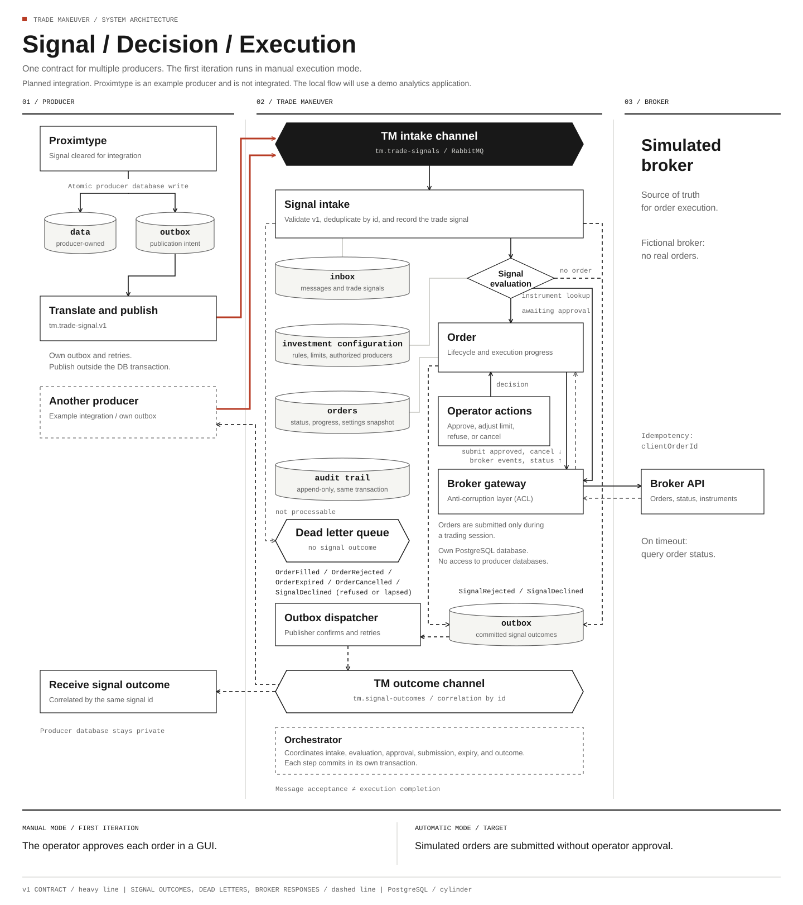
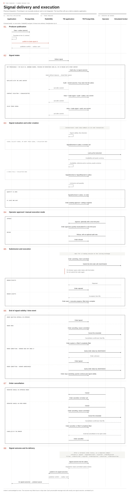

# Trade Maneuver: integration overview

The Trade Maneuver repository contains an
application skeleton; the integration described here is planned. Trade Maneuver is a portfolio and educational project:
the service will receive trade signals from analytics applications and submit orders
to a simulated, fictional broker. It places no real orders, and integration with a real broker is out of
scope. In this document, "broker" means the simulated broker unless stated otherwise.
This document describes the contract and the integration requirements for signal producers.
Proximtype, a separate non-public application, appears here only as an example producer. It is not
integrated with Trade Maneuver, and any analytics application that implements the contract can take
its place. The local flow uses the demo analytics application, a fictional test producer.
The project does not provide services to third parties.

## At a glance

| Question | Answer | Section |
|---|---|---|
| Who owns what? | The analytics application issues a signal; Trade Maneuver decides on an order. A signal is not an order | [1](#1-responsibilities) |
| What is the DDD relationship? | Trade Maneuver is upstream: an Open Host Service with its own intake contract. Proximtype is downstream: one of several possible producers, translating its signal into that contract | [2](#2-ddd-relationship) |
| What crosses the boundary? | A `tm.trade-signal.v1` message, translated from the producer's own signal | [3](#3-contract-tmtrade-signalv1) |
| Which transport? | RabbitMQ, selected in ADR-0003 | [4](#4-transport) |
| What remains open? | Optionality of `expectedMove` | [7](#7-open-decisions) |

## 1. Responsibilities

An analytics application reports its conclusion, for example "DEMO_A short, confidence 0.85, horizon 5 sessions".
Trade Maneuver decides whether, how much, and when to trade.
An analytics application knows nothing about brokers and holds no broker credentials.

| | Proximtype | Trade Maneuver |
|---|---|---|
| Role | Issues a signal | Converts a signal into an order and manages its submission to the broker |
| Integration subject | Analytical signal | Trade signal, which leads to at most one order |
| Integration vocabulary | Signal, confidence, horizon | Order, position, exposure, limit, execution |
| Source of truth | The analytical decision | The order; the broker is the source of truth for execution |

### Execution modes

Trade Maneuver must support two modes:

- Automatic execution mode is the target within the simulation. Signal processing and order
  submission to the broker are fully automatic, without human approval.
- Manual execution mode requires operator approval for each order submission.

The first iteration runs in manual execution mode only.

## 2. DDD relationship

Trade Maneuver is the stable integration point: it accepts signals from multiple analytics
applications, and those applications may change. It therefore owns the contract.

| Party | Pattern | Reason |
|---|---|---|
| Trade Maneuver (upstream) | Open Host Service + Published Language | One intake channel and one contract for all producers; connecting a new producer requires no changes to Trade Maneuver |
| Proximtype (downstream) | Outbound translator | Maps its own signal to the Trade Maneuver contract while keeping its analysis independent |
| Broker gateway in Trade Maneuver | Anti-corruption layer for the broker | The broker's model does not leak into `Order` |
| Outcome channel | Analytics application as a Conformist | It accepts signal outcomes as Trade Maneuver publishes them, without translation |

The reverse arrangement, where Proximtype publishes a contract and Trade Maneuver adapts to it,
would make sense only if Proximtype had multiple consumers and Trade Maneuver had a single producer.

### Open Host Service + Published Language

These two patterns from Evans's context mapping answer two questions:

- Open Host Service answers how the upstream serves its partners: it exposes one open protocol
  for everyone instead of a separate integration for each partner.
- Published Language answers which language they use: a documented, versioned exchange format,
  independent of either party's internal model.

Comparison with other relationships:

| Pattern | Who adapts, and how |
|---|---|
| OHS + PL | The downstream adapts to the protocol by translating its model into the published language |
| Customer/Supplier | The upstream tailors its contract to a particular consumer |
| Conformist | The downstream adopts the upstream model without translation |
| Anti-corruption layer | The downstream translates the external model locally to preserve its own model |

Upstream does not refer to the direction of data flow. Signals flow from Proximtype to Trade Maneuver,
yet Trade Maneuver is upstream, because upstream and downstream describe model influence:
Trade Maneuver defines the message format, so a contract change requires work in Proximtype.

In this integration:

| | Open Host Service | Published Language |
|---|---|---|
| Definition | The `tm.trade-signals` intake channel, the `tm.signal-outcomes` outcome channel, and protocol rules: acknowledgement after commit, deduplication by `id`, producer-specific permissions, and a dead letter exchange | The `tm.trade-signal.v1` and outcome message schemas, a CloudEvents-inspired envelope, versioning rules, and a specification such as AsyncAPI with JSON Schema |
| Trade Maneuver's responsibility | One channel for all producers, without producer-specific paths | Backward compatibility; execution vocabulary without exposing the internal model (`Order` and risk limits stay internal) |
| Producer's responsibility | Producer credentials, its own outbox, and retries | Translation from its own signal to `v1` on its side of the boundary |

In practice, the OHS pattern holds if a second analytics application can connect using credentials
and the `v1` specification, without changes to Trade Maneuver. The contract contains no producer-specific
concepts; `extensions` can carry metadata such as signal strength or alert level. If a new producer
requires a custom field, the relationship shifts toward Customer/Supplier. The pattern commits
Trade Maneuver to stability: a breaking change affects all producers at once.

The intake adapter validates `v1`, maps it to typed application input, and invokes the use case.
The broker gateway provides the anti-corruption layer for the broker's model.
Both diagrams show the planned integration, with Proximtype as the example producer. Proximtype is
not integrated; the tasks build a local flow with the demo analytics application and a simulated
broker. Producer table names in the diagrams are generic.

- A cylinder represents a PostgreSQL table.
- A hexagon represents a channel owned by Trade Maneuver.
- Each service owns its database and does not access another service's database.
- A heavy arrow represents the `v1` contract.
- Dashed arrows represent signal outcomes, which pass through the outbox and its dispatcher to the
  outcome channel, messages that cannot be processed, which go to the dead letter queue, and broker
  responses.
- "Another producer" is an example of a possible integration, not an existing system.

## 3. Contract: `tm.trade-signal.v1`

Trade Maneuver owns the contract, which contains no Proximtype-specific concepts. The envelope
is inspired by CloudEvents (`id`, `source`, `type`, `time`) to keep the schema independent of
transport. Compliance with the CloudEvents specification must be verified before implementation.
The producer maps its own data to the following fields.

| Field | Type | Producer requirement |
|---|---|---|
| `id` | UUID; idempotency key | A stable signal identifier, preserved across retries |
| `source` | Producer identifier | An identifier agreed with Trade Maneuver; it must belong to the RabbitMQ user that publishes the message |
| `type` | `tm.trade-signal.v1` | The fixed contract version |
| `time` | ISO 8601, UTC | Signal creation time |
| `investmentConfigurationRef` | Investment configuration in Trade Maneuver | An identifier agreed with Trade Maneuver; the producer must be authorized for it |
| `instrument.symbol` | String | Instrument symbol |
| `instrument.mic` | String in ISO 10383 MIC format | Four uppercase alphanumeric characters, checked by format only, without a registry lookup; with the symbol, identifies the instrument |
| `direction` | `long` \| `short` | Signal direction |
| `confidence` | Decimal string, 0–1 | Confidence on the contract's scale |
| `horizon.sessions`, `horizon.at` | Integer, date | Signal horizon |
| `expectedMove.min`, `.max` | Decimal percentage string? | Expected movement range; optionality to be agreed |
| `referencePrice.amount`, `.currency`, `.asOf` | Decimal string, ISO 4217 code, ISO 8601 UTC | Required; the currency must equal the instrument's quote currency |
| `validUntil` | ISO 8601, UTC | End of signal validity, set by the producer under its own rule; may span several trading sessions |
| `extensions` | Object; not interpreted by Trade Maneuver | Optional producer metadata, unnecessary for execution |

Contract rules:

- The simulation uses fictional symbols starting with `DEMO_` and the fictional exchange code
  `DEMO`. This code has the MIC format and does not identify a real exchange. Intake checks only
  the format; evaluation declines an instrument unknown to the simulated broker with
  `InstrumentUnavailable`. It does not depend on a live MIC registry lookup.
- Publish only signals that the producer's own rules clear for integration.
- Represent decimal values as strings, without conversion through `float`. Amounts, prices, and
  financial calculations need exact decimal arithmetic with explicit precision and rounding rules,
  because binary floating-point representation can introduce rounding errors; see
  [PostgreSQL exact numeric types](https://www.postgresql.org/docs/current/datatype-numeric.html#DATATYPE-NUMERIC-DECIMAL).
- Exclude human-facing analytical content. Reasoning and summaries stay with the producer;
  the contract carries the data Trade Maneuver needs to process the signal.
- The outcome channel is part of the contract. Each message taken from the intake channel ends
  with exactly one signal outcome, correlated by the same `id`: `SignalRejected` (contract violation or
  contradictory data), `SignalDeclined` (with a reason code), `OrderRejected`, `OrderFilled`,
  `OrderExpired`, or `OrderCancelled`. The last two carry the executed quantity. Only the terminal
  outcome is published; there are no intermediate progress events.
- A message that cannot be correlated or routed receives no signal outcome. This covers a message
  without a valid `id`, one whose `source` is not a known producer, and one whose `source` does not
  belong to the publishing RabbitMQ user. Trade Maneuver logs and audits such a message and
  routes it to the dead letter exchange for manual inspection. A message that reuses an `id` with
  different content is not processed and receives no second outcome; Trade Maneuver records the
  conflict in its audit trail and routes the message to the dead letter exchange.
- `SignalDeclined` carries one of the decline reasons `UnsupportedDirection`, `UnsupportedCurrency`,
  `InstrumentUnavailable`, `OrderAmountTooSmall`, `RefusedByOperator`, or `SignalExpired`. Consumers
  must tolerate codes added later.
- `validUntil` sets the signal validity for the whole signal. An order that has not been approved or
  submitted by then is not placed (`SignalDeclined` with `SignalExpired`); an order still open at the
  broker is cancelled (`OrderExpired`). The horizon does not extend signal validity.
- The first iteration only buys: a `short` signal is declined with `UnsupportedDirection`.
  It also trades only instruments quoted in the investment configuration's currency.
- A new optional field or a new decline reason code stays in v1. Any other change requires v2,
  which is accepted alongside v1 until producers migrate.
- Messages must be complete: the producer provides all required data before publication.
  Trade Maneuver does not retrieve missing information from the producer's database.

## 4. Transport

RabbitMQ is the selected integration transport. Signals use the `tm.trade-signals` exchange;
signal outcomes use `tm.signal-outcomes`, with a separate queue for each producer. Implementation is pending.
[ADR-0003](ADR/adr-0003-rabbitmq-for-integration-messaging.md) records the alternatives,
selection rationale, delivery configuration, and operational consequences.

### Delivery requirements

- Each producer, Proximtype included, needs its own outbox and translates its data to `v1`
  before publication. On the producer's side, a data change that requires publication must be
  committed atomically with its publication intent; sending to Trade Maneuver happens outside
  that transaction.
- Retries must survive Trade Maneuver downtime. The producer stores unsent messages durably
  and retries with a strategy that accounts for `validUntil`. Exhausted retries or
  signal expiry require a recorded outcome and failure handling.
- Delivery is at least once. Trade Maneuver deduplicates by `id` in its inbox within the
  write transaction.
- The producer identifies itself through the AMQP `user_id` property. Each message carries
  `user_id` set to the producer's RabbitMQ user. RabbitMQ rejects a publication whose `user_id`
  differs from the connection's user, so the property proves the publisher. Producer users never
  receive the `impersonator` tag. Trade Maneuver dead-letters a message without `user_id`.

## 5. Message flow

The diagram shows the first iteration's flow: intake acknowledged after commit, signal rejection and
dead-lettering at intake, signal evaluation and order creation, operator approval in manual execution
mode, submission during a trading session, lapse and expiry at the end of signal validity, order
cancellation, and signal outcome delivery through the outbox and RabbitMQ.

## 6. Trade Maneuver rules

1. Deduplication by `id` is mandatory. A duplicate signal must not produce a second order.
2. Acknowledge only after commit. Acknowledging before persistence loses the signal on
   failure. Acknowledging after persistence can cause redelivery, which deduplication handles.
3. An uncertain broker outcome requires a status check. After a timeout, check the order
   instead of submitting it again. A `clientOrderId` derived from `orderId` lets the broker
   reject duplicates.
4. Use an orchestrator. An order already placed cannot be undone; an opposite order
   is a new business decision.
5. Preserve the correlation signal `id` → `orderId` → `brokerOrderId` in logs and the audit trail.

Periodic reconciliation of orders and positions with the broker is out of scope.

## 7. Open decisions

- Optionality of `expectedMove`: agree whether producers must always provide the expected
  movement range.
