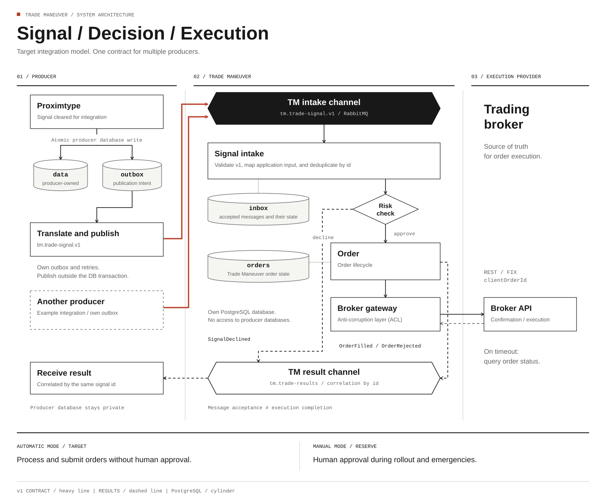
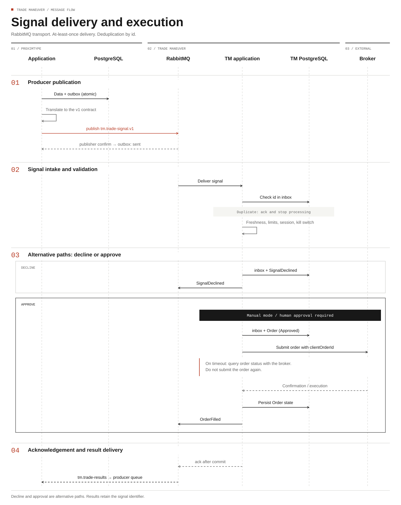

# Proximtype → Trade Maneuver: integration overview

Concept drafted on 2026-10-26, updated on 2026-10-27. The Trade Maneuver repository contains an
application skeleton; the integration described here is planned. The service will receive signals
from analytics applications such as Proximtype and submit orders to an execution provider
(a trading broker). This document describes the contract and integration requirements for signal producers.
The current scope does not include providing services to third parties.

## At a glance

| Question | Answer | Section |
|---|---|---|
| Who owns what? | The analytics application issues a signal; Trade Maneuver decides on an order. A signal is not an order | [1](#1-responsibilities) |
| What is the DDD relationship? | Trade Maneuver is upstream: an Open Host Service with its own intake contract. Proximtype is downstream: one of several possible producers, translating its signal into that contract | [2](#2-ddd-relationship) |
| What crosses the boundary? | A `tm.trade-signal.v1` message, translated from the producer's own signal | [3](#3-contract-tmtrade-signalv1) |
| Which transport? | RabbitMQ, selected in ADR-0003 | [4](#4-transport) |
| What remains open? | Signal validity | [7](#7-open-decisions) |

## 1. Responsibilities

Proximtype reports the model's conclusion: “EWQ short, confidence 0.85, horizon 5 sessions”.
Trade Maneuver decides whether, how much, when, and through which execution provider to trade.
Proximtype has no knowledge of brokers and holds no broker credentials.

| | Proximtype | Trade Maneuver |
|---|---|---|
| Role | Issues a signal | Converts a signal into an order and manages its submission to the broker |
| Integration subject | Analytical signal | Execution instruction; the target order model still needs refinement |
| Integration vocabulary | Signal, confidence, horizon | Order, position, exposure, limit, execution |
| Source of truth | The model's decision | The order; the broker is the source of truth for execution |

### Execution modes

Trade Maneuver must support two modes:

- **Automatic execution mode: the target.** Signal processing and order submission to the broker
  are fully automatic, without human approval.
- **Manual execution mode: the reserve.** Order submission requires human approval. This mode
  provides control during the initial rollout and remains available as a fallback in emergencies.

## 2. DDD relationship

Trade Maneuver is the stable integration point: it accepts signals from multiple analytics
applications, and those applications may change. It therefore owns the contract.

| Party | Pattern | Reason |
|---|---|---|
| Trade Maneuver (upstream) | Open Host Service + Published Language | One intake channel and one contract for all producers; connecting a new producer requires no changes to Trade Maneuver |
| Proximtype (downstream) | Outbound translator | Maps its own signal to the Trade Maneuver contract while preserving the independence of its model |
| Broker gateway in Trade Maneuver | Anti-corruption layer for the execution provider | The broker's model (REST, FIX) does not leak into `Order` |
| Result channel | Proximtype as a Conformist | Proximtype only displays `SignalDeclined` and `OrderFilled`, so it accepts them without translation |

The reverse arrangement, where Proximtype publishes a contract and Trade Maneuver adapts to it,
would make sense only if Proximtype had multiple consumers and Trade Maneuver had a single producer.

### Open Host Service + Published Language

These two patterns from Evans's context mapping address two questions:

- **Open Host Service: how** the upstream serves its partners. It exposes one open protocol
  for everyone rather than a separate integration for each partner.
- **Published Language: which language.** A documented, versioned exchange format, independent
  of either party's internal model.

Comparison with other relationships:

| Pattern | Who adapts, and how |
|---|---|
| OHS + PL | The downstream adapts to the protocol by translating its model into the published language |
| Customer/Supplier | The upstream tailors its contract to a particular consumer |
| Conformist | The downstream adopts the upstream model without translation |
| Anti-corruption layer | The downstream translates the external model locally to preserve its own model |

**Upstream does not describe data flow.** Signals flow from Proximtype to Trade Maneuver,
while Trade Maneuver is upstream. Upstream and downstream describe model influence:
Trade Maneuver defines the message format, so a contract change requires work in Proximtype.

In this integration:

| | Open Host Service | Published Language |
|---|---|---|
| Definition | The `tm.trade-signals` intake channel, the `tm.trade-results` result channel, and protocol rules: acknowledgement after commit, deduplication by `id`, producer-specific permissions, and a dead letter exchange | The `tm.trade-signal.v1` and result message schemas, a CloudEvents-inspired envelope, versioning rules, and a specification such as AsyncAPI with JSON Schema |
| Trade Maneuver's responsibility | One channel for all producers, without producer-specific paths | Backward compatibility; execution vocabulary without exposing the internal model (`Order` and risk limits stay internal) |
| Producer's responsibility | Producer credentials, its own outbox, and retries | Translation from its own signal to `v1` on its side of the boundary |

The practical OHS check: a second analytics application can connect using credentials and the
`v1` specification without changes to Trade Maneuver. The contract contains no producer-specific
concepts; `extensions` can carry metadata such as signal strength or alert level. If a new producer
requires a custom field, the relationship moves towards Customer/Supplier. The pattern commits
Trade Maneuver to stability: a breaking change affects all producers at once.

The intake adapter validates `v1`, maps it to typed application input, and invokes the use case.
The broker gateway provides the anti-corruption layer for the execution provider's model.
The diagram shows target integration requirements. Producer table names are generic.

- A cylinder represents a PostgreSQL table.
- A hexagon represents a channel owned by Trade Maneuver.
- Each service owns its database and does not access another service's database.
- A heavy arrow represents the `v1` contract.
- Dashed arrows connected to the result channel represent result delivery.
- “Another producer” is an example of a possible integration, not an existing system.

## 3. Contract: `tm.trade-signal.v1`

Trade Maneuver owns the contract, which contains no Proximtype-specific concepts. The envelope
is inspired by CloudEvents (`id`, `source`, `type`, `time`) to keep the schema independent of
transport. Compliance with the CloudEvents specification must be verified before implementation.
The producer maps its own data to the following fields.

| Field | Type | Producer requirement |
|---|---|---|
| `id` | UUID; idempotency key | A stable signal identifier, preserved across retries |
| `source` | Producer identifier | An identifier agreed with Trade Maneuver |
| `type` | `tm.trade-signal.v1` | The fixed contract version |
| `time` | ISO 8601, UTC | Signal creation time |
| `accountRef` | Account or portfolio in Trade Maneuver | A mapping agreed with Trade Maneuver |
| `instrument.symbol` | String | Instrument symbol |
| `direction` | `long` \| `short` | Signal direction |
| `confidence` | Decimal string, 0–1 | Confidence on the contract's scale |
| `horizon.sessions`, `horizon.at` | Integer, date | Signal horizon |
| `expectedMove.min`, `.max` | Decimal percentage string? | Expected movement range; optionality to be agreed |
| `referencePrice.amount`, `.asOf` | Decimal string?, date? | Reference price and its timestamp; optionality to be agreed |
| `validUntil` | ISO 8601, UTC | Expiry time under an agreed rule (section 7) |
| `extensions` | Object; not interpreted by Trade Maneuver | Optional producer metadata, unnecessary for execution |

Contract rules:

- **Publish only signals cleared for integration** by the producer's own rules.
- **Represent decimal values as strings**, without conversion through `float`. Standard fintech
  practice requires exact decimal arithmetic for amounts, prices, and financial calculations,
  with explicit precision and rounding rules. Binary floating-point representation can introduce
  rounding errors; see [PostgreSQL exact numeric types](https://www.postgresql.org/docs/current/datatype-numeric.html#DATATYPE-NUMERIC-DECIMAL).
- **Exclude human-facing analytical content.** Reasoning and summaries stay with the producer;
  the contract carries the data Trade Maneuver needs to process the signal.
- **The result channel is part of the contract.** Each accepted signal ends with `SignalDeclined`,
  `SignalRejected` (invalid message), `OrderFilled`, or `OrderRejected`, correlated by the same `id`.
- **Versioning.** A new optional field stays in v1; any other change requires v2, accepted
  alongside v1 until producers migrate.
- **Complete messages.** The producer provides all required data before publication.
  Trade Maneuver does not retrieve missing information from the producer's database.

## 4. Transport

RabbitMQ is the selected integration transport. Signals use the `tm.trade-signals` exchange;
results use `tm.trade-results`, with a separate queue for each producer. Implementation is pending.
[ADR-0003](ADR/adr-0003-rabbitmq-for-integration-messaging.md) records the alternatives,
selection rationale, delivery configuration, and operational consequences.

### Delivery requirements

- **Each producer needs its own outbox and translation to `v1`.** This includes Proximtype.
  A data change requiring publication and its publication intent must be committed atomically
  on the producer's side. Sending to Trade Maneuver happens outside that transaction.
  The producer translates its data to the Trade Maneuver contract before publication.
- **Retries must survive Trade Maneuver downtime.** The producer durably stores unsent messages
  and retries according to a strategy that accounts for `validUntil`. Exhausted retries or
  signal expiry require a recorded outcome and failure handling.
- **Trade Maneuver deduplicates by `id`** in its inbox within the write transaction.
  Delivery is at least once.

## 5. Message flow

The diagram shows signal intake and result delivery through RabbitMQ.
Manual execution mode additionally requires human approval before order submission to the broker.

## 6. Trade Maneuver rules

1. **Deduplication by `id` is mandatory.** A duplicate signal must not produce a second order.
2. **Acknowledge only after commit.** Acknowledgement before persistence loses the signal on
   failure. Acknowledgement after persistence can cause redelivery, which deduplication handles.
3. **An uncertain broker outcome requires a status check.** After a timeout, check the order
   instead of submitting it again. A `clientOrderId` derived from `orderId` allows the broker
   to reject duplicates.
4. **Reconcile orders and positions with the broker periodically.** The broker determines
   whether execution has occurred.
5. **Use a Process Manager.** An order already placed cannot be undone; an opposite order
   is a new business decision.
6. **Preserve correlation:** signal `id` → `orderId` → `brokerOrderId`, in logs and the audit trail.

## 7. Open decisions

- **Signal validity (`validUntil`).** Trade Maneuver requires it. Agree on the rule producers
  use to determine the expiry time.
